# Hi, I'm Berkay 👋

**Student in Istanbul · systems, cryptography & hardware tinkerer**

I like building things from first principles: crypto primitives in Rust, VPNs, homelab infrastructure,
console mods and emulators. Aiming for electronics + physics.

---

### 🔨 Featured project

#### [🔐 easylock](https://github.com/zlixas/easylock)
A cryptography toolkit written **from scratch in Rust** with zero dependencies: AES, ChaCha20, Curve25519,
RSA, Argon2id and post-quantum **ML-KEM**. CLI, terminal UI, desktop app and an
[offline web app](https://zlixas.github.io/easylock/) that share one encrypted file format.

`Rust` `WebAssembly` `Tauri` `post-quantum`

### 🧰 What I work with

### 🔬 Currently exploring

- Low-level emulation and console hardware (Xbox 360 Xenon, PS2 + RP2040)
- Writing an OS from scratch: bootloader and kernel
- Homelab: self-hosted services, proxies and local LLMs

